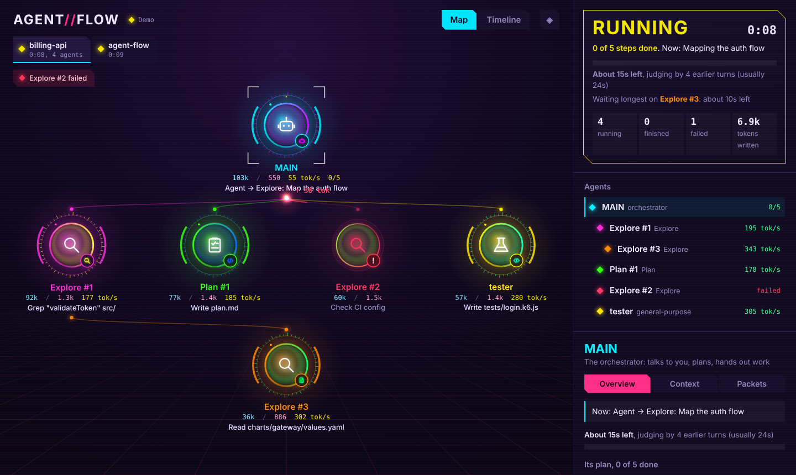

# AGENT//FLOW

See what your Claude Code agents are doing, live.

When Claude starts subagents, it is hard to tell who is doing what, how far along they are, and when the work will be done. AGENT//FLOW draws it for you: every agent, the tasks passed between them, and how many tokens they use.



## What you get

- **A live map.** Each agent is a glowing circle. Running agents have spinning rings; finished ones go quiet. An icon in the middle shows the kind of work (search, plan, code, review, test…). Drag the circles to arrange them.
- **"Is it done yet?"** A status box shows RUNNING or DONE, how many planned steps are finished, and a time estimate based on earlier runs. Turn on the bell to get a sound and a notification when it finishes.
- **Every message.** Click any task or report to read it in full: the exact prompt an agent was given and the answer it sent back.
- **What each agent sees.** The Context tab lists what is in an agent's context window: its task, its tool calls, and the results.
- **A timeline.** When each agent started and finished, how fast it wrote, and every tool call.
- **One tab per session.** Running Claude Code in several windows? Each one gets its own tab.

Finished agents leave the map after a minute so you can focus on what is running. Click "Show" to bring them back.

## Install

You need Claude Code with mod support. Works on macOS, Windows, Linux and WSL.

```sh
claude plugin marketplace add quanglewin/agent-flow-mod
claude plugin install agent-flow@claude-mods
```

Then, in each open Claude Code window, run:

```
/reload-plugins
```

## Use

In Claude Code:

| Command | What it does |
|---|---|
| `/agent-flow web` | Open the dashboard in your browser |
| `/agent-flow web demo` | Play a demo, no real agents needed |
| `/agent-flow web off` | Stop sending this session to the dashboard |
| `/agent-flow` | Show the map inside Claude Code (terminal or desktop app) |
| `/agent-flow compact` or `detail` | Circles or cards inside Claude Code |
| `/agent-flow reset` | Clear the map |

Tip: in the Ghostty or kitty terminal, the map inside Claude Code is drawn with real pixels.

## Update

```sh
claude plugin marketplace update claude-mods
```

Then run `/reload-plugins` in Claude Code.

## Uninstall

```sh
claude plugin uninstall agent-flow@claude-mods
```

## Where the files go

The dashboard is a plain HTML file on your computer. There is no server, and nothing is sent anywhere.

- macOS, Windows, WSL: `~/.claude/agent-flow/`
- Linux desktop: `~/agent-flow/` (Snap browsers cannot open hidden folders)
- Or set `AGENT_FLOW_DIR` to any folder you like.

## Privacy

The mod reads what Claude Code shares with mods: agents starting and stopping, token counts, tool calls, messages between agents, and each agent's conversation (for the Context tab). It writes this only to the folder above. A mod runs inside Claude Code with the same access as Claude Code, so read the code before you install any mod, including this one.

## Troubleshooting

| Problem | Fix |
|---|---|
| `Unknown command: /agent-flow` | Run `/reload-plugins`, or restart Claude Code. |
| The dashboard says "Waiting" or shows no tabs | Run `/agent-flow web` in the session you want to watch. |
| A tab says "No data" | That session is closed or still runs an old version. Run `/reload-plugins` in it. |
| An agent is called "agent #2" | It started before the mod was loaded. New agents get real names. |

## Develop

```sh
claude plugin validate .
claude plugin test .
```

Change the files, then run `/reload-plugins` in Claude Code.

- `hooks/register.tsx`: entry point, listens to Claude Code events
- `hooks/model.ts`: the agent graph
- `hooks/context.ts`: reads each agent's context
- `web/index.html`: the browser dashboard

## License

MIT
